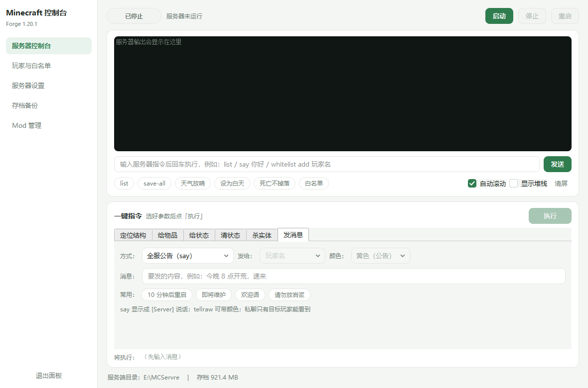
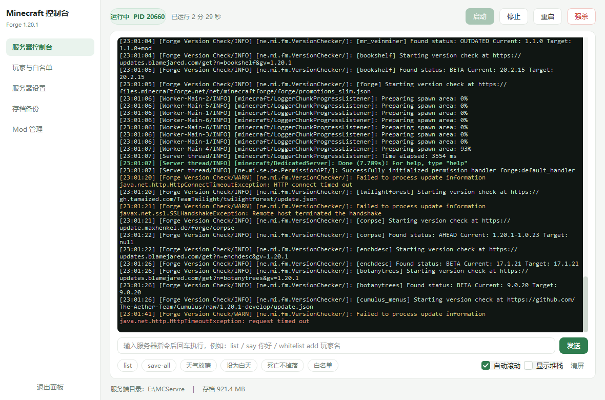
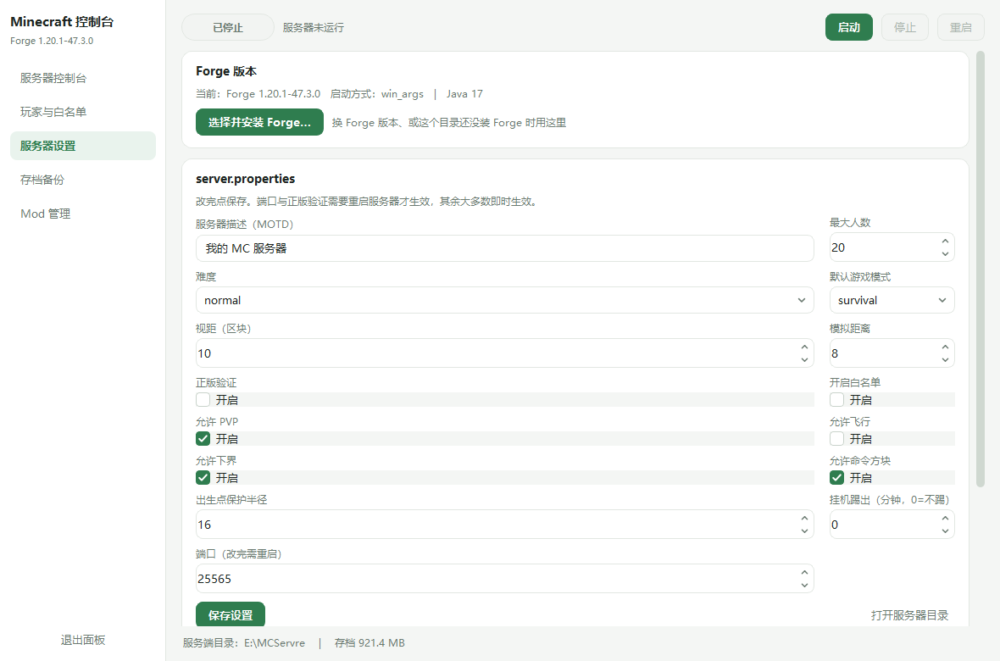

# MC Server Panel

给 Minecraft 模组服用的**图形化控制台**。原生桌面窗口，不开浏览器、不监听端口、不需要命令行。

> 这不是游戏启动器，也不带任何 Mojang 的游戏文件 —— 它只负责管好你**已经装好**的那个服务端目录。
> Not affiliated with Mojang Studios or Microsoft.



## 为什么写它

开模组服最烦的不是装 mod，是日常运维：看日志、敲 `stop`、改 `server.properties`、加白名单、
备份存档、临时关掉某个 mod。这些东西全靠一个黑窗口和记事本，一不留神还会直接叉掉窗口把存档写坏。

这个面板把这些动作都变成了按钮，并且守住两条底线：

- **停服一律通过 stdin 发送 `stop`**，等服务器把存档写完，绝不强杀
- **备份是热备**：`save-off` → `save-all flush` → 打包 → `save-on`，运行中也能安全备份

## 功能

| 模块 | 说明 |
|---|---|
| 进程管理 | 启动 / 停止 / 重启 / 强杀；状态机区分 启动中 / 运行中 / 关闭中 |
| **Forge 安装** | 界面里选 Minecraft 版本 + Forge 构建号，自动下载官方安装器并执行 `--installServer`；已装好的任意版本自动识别 |
| 实时控制台 | 日志按级别着色，Java 堆栈自动折叠；指令输入框带 ↑↓ 历史 |
| 一键指令 | 定位结构 / 给物品 / 给状态 / 清状态 / 杀实体 / 发消息，全部下拉选，底部实时显示生成的原版指令 |
| 玩家 | 在线列表、踢人、设 OP；**白名单 ⇄ 黑名单一键切换**，离线账号 UUID 本地计算，封禁列表可视化增删 |
| 服务器设置 | `server.properties` 常用项可视化编辑；JVM 内存 Xms/Xmx |
| 存档管理 | 手动备份 + 定时自动备份；**多存档切换 / 新建**（改 `level-name`，支持种子与世界类型，重启生效） |
| Mod 管理 | 勾选启停，关掉的移到 `mods-disabled`（不删除），可搜索 |






## 运行要求

- Windows 10 / 11（64 位）。目前只支持 Windows —— 用到了 Job Object、注册表、`SHBrowseForFolderW` 等 Win32 API
- 一个服务端目录（含 `server.properties`）。**里面还没装 Forge 也可以**，程序内置 Forge 下载安装
- Java 需与 Minecraft 版本匹配：1.20.5+ / 1.21+ → Java 21；1.18–1.20.4 → Java 17；1.17 → Java 16
  Java 按以下顺序查找：`<服务端>/runtime/bin/java.exe` → `%JAVA_HOME%` → `PATH` 里的 `java`
- 从源码运行需要 Python 3.10+ 与 PySide6 6.5+

## 换 Forge / Minecraft 版本

设置页 →「Forge 版本」→「选择并安装 Forge…」：

1. 下拉里选 Minecraft 版本（列表来自 BMCLAPI，78+ 个版本）
2. 选 Forge 构建号（会标出官方 `recommended` / `latest`）
3. 选安装源：默认 **BMCLAPI 国内镜像**，也可以切官方 maven
4. 点「下载并安装」—— 程序下载官方安装器，跑到 `<服务端目录>` 执行 `--installServer --mirror <镜像>`，进度和日志实时显示

> Forge 安装器默认从 `maven.minecraftforge.net` 拉依赖，在国内经常拉一半断连（日志里表现为 `Failed to establish connection`）。
> 安装器本身支持 `--mirror`，所以默认传 BMCLAPI 的 maven 镜像，实测能装完。失败可以直接重试，已下载的文件会复用。

装好后程序会自动识别，不需要手动改配置。启动方式两种都支持：

- **1.17+**：`libraries/net/minecraftforge/forge/<mc>-<forge>/win_args.txt`
- **1.16.5 及更早**：根目录的 `forge-*-universal.jar`（直接 `-jar` 启动）

> 安装器会往目标目录写 `libraries/`、`run.bat` 等文件并下载数百 MB 依赖。已有存档的服建议先备份。

## 从源码运行

```bash
pip install -r requirements.txt
python app.py
```

程序会从自身所在目录向上查找 `server.properties` 来确定服务端根目录，
所以把源码放在服务端目录里，或它下面的任意子目录（例如 `panel/`）都能工作。

## 构建 exe

```bash
pip install -r requirements-dev.txt
build.bat
```

产出：

| 文件 | 说明 |
|---|---|
| `dist\MCPanel.exe` | 单文件版，自用方便 |
| `dist\MCPanel-Setup.exe` | 安装包，内嵌单文件版 |
| `dist\MCPanel-portable\` | **目录版，发布二进制时请用它**（Qt 的 dll 在 `_internal\PySide6\` 里，可替换，符合 LGPL 要求） |

## 安装包做了什么

`setup.py` 是一个带向导的安装器：

- 自动探测安装包附近的 `server.properties`，弹框确认；没有则调系统文件夹选择器手动指定
- **只往 `<服务端目录>\panel\` 写程序**，不动 `world` / `mods` / `config` / `server.properties`
- 生成桌面与开始菜单快捷方式，写 `HKCU\...\Uninstall\MCPanel` 卸载项
- 卸载时询问是否保留 `panel\backups` 里的存档 zip

静默安装（便于脚本化）：

```bat
MCPanel-Setup.exe --silent --dir=D:\mcserver
```

## 目录结构

```
.
├── app.py                 Qt 界面（窗口、页签、定时刷新）
├── quickcmd.py            一键指令面板（指令构造与校验）
├── forge_dialog.py        Forge 版本选择 / 下载 / 安装对话框
├── core.py                后端核心（进程管理、日志解析、备份、配置、白名单/黑名单、存档切换）
├── setup.py               安装器
├── icongen.py             程序化生成图标（不依赖 Pillow）
├── build.bat              打包脚本
├── assets/                图标与 SVG
├── LICENSES/              LGPLv3 / GPLv3 全文（分发二进制时需要）
└── docs/                  截图
```

## 安全与隐私

- 只在**本机**运行，不监听任何端口，不联网（Minecraft 自己的版本检查除外）
- 只读写服务端目录内的文件
- 面板自身日志写在 `panel\logs\panel.log`，出问题先看它
- 单实例运行；通过 Windows Job Object（`KILL_ON_JOB_CLOSE`）保证面板被强制结束时不会留下孤儿 Java 进程

## 已知限制

- 仅 Windows；界面仅中文
- Forge 版本靠 `detect_forge()` 自动探测（win_args.txt 或 forge-*.jar），目录结构特殊时需要改它
- 未做代码签名，首次运行 Windows SmartScreen 会提示「更多信息 → 仍要运行」
- 备份是整份 zip，不增量；存档很大时（数 GB）请自行评估磁盘空间

## 许可

本项目代码以 [MIT](LICENSE) 发布。

第三方组件（PySide6 / Qt 为 LGPLv3，PyInstaller 为 GPLv2+例外）的许可义务见
[THIRD-PARTY-NOTICES.md](THIRD-PARTY-NOTICES.md)。**发布二进制版本请使用目录版并随包附带 `LICENSES/`。**

---

## English

A native Windows desktop panel for managing a Minecraft modded server (Forge/NeoForge):
process control with graceful `stop`, live log console with command input, whitelist/OP management
with offline-UUID calculation, `server.properties` editing, hot backups (`save-off`/`flush`/`save-on`),
and mod toggling.

Windows only. Requires an existing server directory containing `server.properties`.
Run from source with `pip install -r requirements.txt && python app.py`.

MIT licensed. Not affiliated with Mojang Studios or Microsoft.
